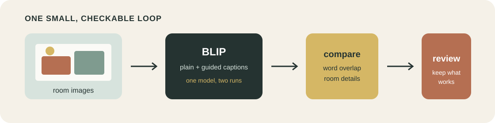
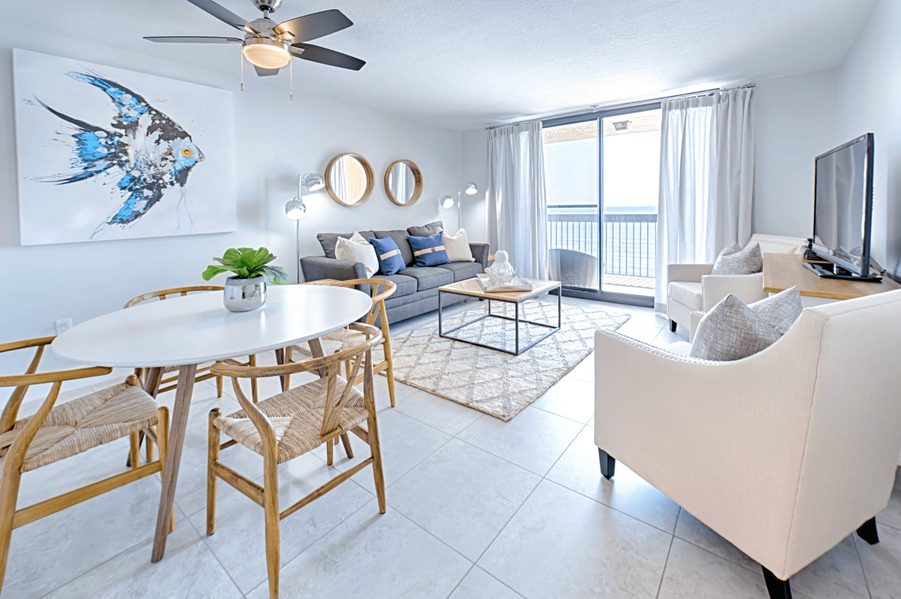

# Room Captioner

The original code and documentation are available under the [MIT License](LICENSE). `assets/example-room.jpg` and its reference caption come from the [ellljoy/interior-design dataset](https://huggingface.co/datasets/ellljoy/interior-design) and remain under [Apache License 2.0](THIRD_PARTY_LICENSES/Apache-2.0.txt); they are not relicensed as MIT.

Turn a folder of interior photos into useful captions, then check whether a small domain prompt actually helps.

This repo is deliberately compact. There is one public dataset, one public model, four commands, and no hidden state to untangle. You can read the whole pipeline in a few minutes and swap in your own room photos whenever you are ready.



## One room, two captions



| Version | Caption |
| --- | --- |
| Baseline | `a living room filled with furniture and a flat screen tv` |
| Guided | `a living room with a dining table and chairs` |
| Dataset reference | `a living room with a dining table and chairs` |

The baseline notices the room and television, but falls back to the vague word "furniture." The short prompt gets a more useful caption by naming the dining area and chairs. This is exactly the kind of change the comparison step is meant to catch.

<sub>Image and reference caption from the Apache 2.0 licensed <a href="https://huggingface.co/datasets/ellljoy/interior-design">ellljoy/interior-design</a> dataset.</sub>

## What happens here?

We start with [ellljoy/interior-design](https://huggingface.co/datasets/ellljoy/interior-design), a public Apache 2.0 dataset with 30 living-room images and short reference captions. We caption those rooms with [Salesforce BLIP Base](https://huggingface.co/Salesforce/blip-image-captioning-base), released under BSD 3-Clause.

The same photos go through the model twice:

| Run | Text given to the model | Why it is here |
| --- | --- | --- |
| Baseline | none | Shows what the model says on its own |
| Guided | `a living room with` | Fits the model to this dataset's room type |

After that, a small evaluator lines both runs up with the dataset captions. It reports word precision, recall, F1, caption length, interior terms, and how often captions are unique. These are quick signals for comparing runs, not a final verdict on writing quality. Read a few captions yourself before deciding which setup is better.

Here is the shape of one saved result:

```json
{
  "image": "room_000.jpg",
  "caption": "a living room with a dining table and chairs",
  "mode": "guided",
  "prompt": "a living room with",
  "model": "Salesforce/blip-image-captioning-base"
}
```

## Try it

You need Python 3.10 to 3.12 and [uv](https://docs.astral.sh/uv/). A CUDA GPU makes captioning faster, but the code also runs on CPU.

```bash
git clone <your-repo-url>
cd simple-image-captioner
uv sync
```

The model is about 1 GB and downloads on the first captioning run. It is cached after that.

### 1. Get a few rooms

```bash
uv run room-captioner download --limit 12
```

This creates `data/images/` and `data/references.jsonl`. Use `--limit 30` when you want the full dataset.

### 2. Make the plain captions

```bash
uv run room-captioner caption --mode baseline
```

The results land in `data/outputs/baseline.jsonl`.

### 3. Add the interior hint

```bash
uv run room-captioner caption --mode guided
```

Now you also have `data/outputs/guided.jsonl`. Open both files and compare a couple of matching lines. That quick spot check is often more revealing than one score.

### 4. Compare the runs

```bash
uv run room-captioner compare
```

The terminal shows the averages and the full report is saved to `data/outputs/comparison.json`. Positive values under `change` mean the guided run scored higher for that measurement.

You can inspect either run on its own too:

```bash
uv run room-captioner evaluate data/outputs/guided.jsonl
```

## Use your own photos

Drop JPG, PNG, or WebP files into a folder and point the caption command at it:

```bash
uv run room-captioner caption \
  --images path/to/my/rooms \
  --mode guided \
  --output data/outputs/my_rooms.jsonl
```

References are only needed for `evaluate` and `compare`. Captioning your own folder works without them.

For another kind of room, supply your own caption opening:

```bash
uv run room-captioner caption --images path/to/kitchens --prompt "a kitchen with"
```

Keep it short. BLIP treats the prompt as the beginning of the caption, so a long instruction usually makes the result worse rather than smarter. The built-in modes live in `room_captioner/pipeline.py` if you want to keep a new preset.

## The code map

```text
room_captioner/
├── cli.py          commands and their arguments
├── data.py         dataset download and local file names
├── model.py        BLIP loading and one-image captioning
├── pipeline.py     folder processing and JSONL output
└── evaluation.py   readable comparison metrics
tests/              fast tests that do not download a model
main.py             a plain Python entry point
```

Each module has one job. `main.py` is kept for anyone who prefers `uv run python main.py ...`; it accepts the same commands as `room-captioner`.

## A sensible next experiment

Change one thing at a time. Try a shorter prompt, add a few carefully written references, or replace the model behind `BlipCaptioner`. Save each run under a new name and compare it with the same image set. That keeps the result explainable and saves you from guessing why a caption changed.

## Checks

The tests cover file ordering, JSONL output, token cleanup, and metric calculations. They use a tiny stand-in captioner, so they finish without network access or model weights.

```bash
uv run pytest
```

## A couple of honest limits

BLIP Base is approachable and easy to run, but it can miss fine materials, design styles, and spatial relationships. The dataset captions are short, so overlap scores can also punish a perfectly reasonable phrase that uses different words. Treat this repo as a clear baseline and experiment loop, not a claim that room captioning is solved.
